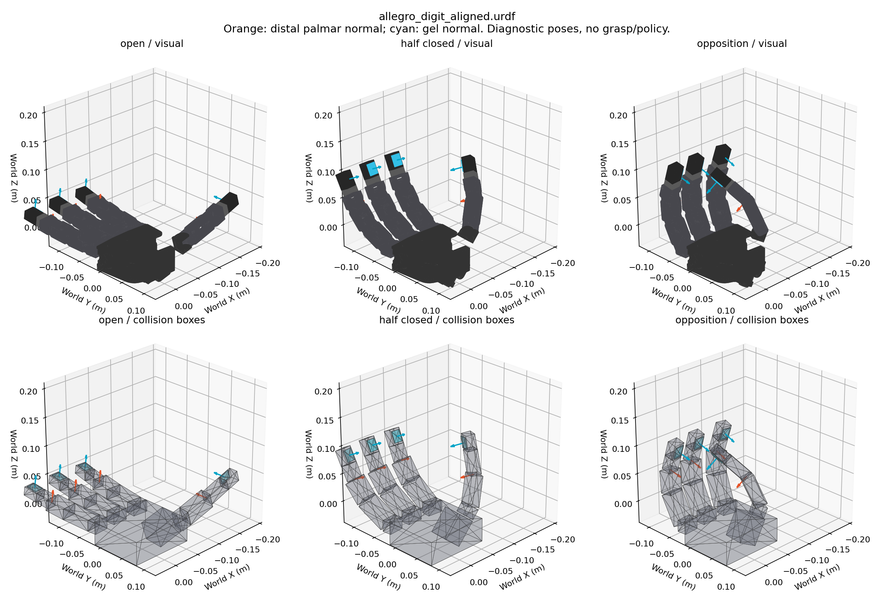

> **历史记录：本页描述已被替代的方盒代理方案。** 当前默认已切换到[官方网格装配](official_digit.md)。
> 本次已取得FeelSight资产并核验；下文“未取得”是前次检查时的情况。旧掌部穿插已在新资产中修复。
> 旧参数移至 `configs/digit_mount_aligned_proxy.yaml`；此页数值和测试只适用于 `allegro_digit_aligned.urdf`。
> 静态复查旧模型请显式指定 `--asset assets/allegro/allegro_digit_aligned.urdf`；默认预览现在显示新模型。

# DIGIT 直线装配修正与验收边界

## 硬件依据

DIGIT 是带摄像头、照明、胶体和外壳的完整光学触觉模块，不是无厚度的贴片。
原始论文 §III-A 给出整机约20×27×18 mm、20 g；其中18 mm是厚度。
官方仓库说明其兼容Allegro，并提供适配器。替换的是末端固定指尖部件，
不是增加主动关节；实际可拆部件、安装孔、线缆和负载必须按手的具体型号核对。

NeuralFeels §4.2 说明其在Allegro四个末端安装四个DIGIT，手安装在Franka Panda上。
公开代码使用左手资产 `data/assets/allegro/allegro_digit_left_ball.urdf`，
关节运动学先定位指尖，再通过固定变换转到触觉重建坐标系。
本次读到了论文和代码，但未成功取得FeelSight大压缩包中的该URDF，不能声称复现了其支架尺寸或安装角度。

AnyRotate不同：附录J明确其为基于DigiTac/TacTip的自研曲面光学指尖，
通过内部标记针运动感知接触。论文给出(拇指、食指、中指、无名指)安装偏置
(-45°、-45°、0°、+45°)。这说明所有传感器都必须与指腹共面不是通用规律，
但它不能为旧模型40–57°俯仰、拇指-90°偏航提供依据。
本项目依用户要求先建立共面直线DIGIT刚体基线，不称为AnyRotate或NeuralFeels装配复现。

来源：

- [DIGIT原始论文 §III-A](https://arxiv.org/html/2005.14679)
- [官方Allegro适配器](https://github.com/facebookresearch/digit-design/tree/de292229d43eed1deba58b856b2fe1ee04097631/DIGIT/adaptors/Allegro)
- [NeuralFeels §4.2](https://arxiv.org/html/2312.13469v1#S4.SS2)
- [NeuralFeels Allegro运动学代码](https://github.com/facebookresearch/neuralfeels/blob/36398b861c05a66868490fa43dfb7742cf345386/neuralfeels/modules/allegro.py)
- [AnyRotate附录J](https://arxiv.org/html/2405.07391v2#A10)

## 实际改动

旧 `assets/allegro/allegro_digit.urdf` 保持原样，供旧配置和权重回放。
新增 `assets/allegro/allegro_digit_aligned.urdf`；`configs/digit_mount.yaml` 和生成器默认产生新资产。
`manip`及继承它的配置指向新资产，各自使用新名称的 `_aligned_grasps.pt`，避免覆盖旧缓存。
这些新缓存尚不存在，此次没有生成抓取、训练或调整物体尺寸。

新装配在每个末节的局部坐标系中定义：

- +X为指腹向外法向，+Z为末节长轴；四个安装RPY均为0。
- 原末节显示网格前沿包络为x=9.8 mm。胶面外表面同样位于x=9.8 mm。
  这是名义参考平面的对齐，不表示曲面指腹或真实弹性胶面处处平坦。
- 保留外壳16×20×27 mm、胶体2×16×20 mm与0.1 mm间隙：组合厚度18.1 mm。
  质量仍为旧模型的20+2 g，没有冒充原论文整机20 g的精确质量/惯量模型。
- 外壳中心x=-0.3 mm、y=0；三根长指z=40.2 mm，拇指z=55.8 mm。
  外壳近端恰接原末节碰撞盒末端26.7/42.3 mm，不再与末节盒体积重叠。
  这些位置是由上述代理几何推导，未经实物标定。
- 原末节网格末端15.7/31.3 mm，碰撞盒却延伸到26.7/42.3 mm。
  给这已有的11 mm碰撞区域增加灰色连接件显示，使显示能表达已有支撑；
  未增加碰撞形状、刚体、关节或质量。它是代理连接件，不是已核实的官方支架。
- 仍为16个主动关节、25个手部刚体。掌部/指节碰撞形状、碰撞过滤、控制与奖励未改动。

这次不仅改变外观，也改变了DIGIT碰撞体的位置和方向，因此资产SHA256已变。
旧缓存/权重不能直接用于新资产。旧实验配置仍指向旧URDF，所以回放旧权重时仍会显示旧装配。

## 检查结果

程序 `scripts/inspect_digit_mount.py` 使用URDF正运动学，在张手、半握、对握三种明确关节角下
检查胶面法向、外壳长轴与指腹参考平面。使用15轴分离轴检验检查碰撞盒体积重叠；
单纯表面相接不算体积重叠。固定组件/相邻连接的过滤对单独报告，不隐去异常。

三姿态四指的法向/长轴误差均在1e-5度内，平面偏差在1e-8 mm内，
均未发现DIGIT与其他启用碰撞的手部件发生体积重叠。
但原掌部盒与 `link_13.0` 在张手、半握的最小投影重叠分别约7.50、4.90 mm。
旧模型具有同样的掌部/拇指问题；这不是新DIGIT几何引入的。
对握诊断姿态没有启用碰撞对的体积重叠。姿态为诊断用，不是已筛选的稳定抓取。

实际PhysX也验证了这一问题：使用任务原有的限力矩PD保持三姿态120个物理步（约1秒），
物体移出手部，张手/半握仅报告 `base_link`—`link_13.0` 接触，对握无手部接触。
张手/半握初始穿插导致约4821/956 N的峰值数值接触力；这是仿真初始穿插的异常反应，
不是实际硬件受力能力。不能据此验收整手模型，更不能用关闭该碰撞对来掩盖问题。
应另行校准掌部及拇指基部碰撞形状，再筛选抓取和继续训练。

18项测试通过；3环境、30控制步GPU smoke通过，状态/奖励有限。
服务器无GUI，实际窗口显示尚需本地检查。静态显示/碰撞图已在服务器生成并审阅。
证据位于项目根目录 `research/digit_mount_review/`，其中抓取/训练产物不参与本次检查。



## 本地复查，不需要传输权重

代码和新URDF都走Git。安装环境与SDK后，在 `In_Hand_Manip/` 执行：

```bash
# 生成三姿态对照图及JSON；不需要GPU/Isaac Gym。
python -s scripts/inspect_digit_mount.py
xdg-open ../research/digit_mount_review/allegro_digit_aligned.png

# 使用Isaac Gym查看独立模型；默认对握，无策略、无抓取缓存。
bash scripts/python_manip.sh scripts/inspect_digit_mount_sim.py --pose opposition
# 张手/半握仍有上述已知掌部碰撞，会在PD保持时偏离指定姿态。
bash scripts/python_manip.sh scripts/inspect_digit_mount_sim.py --pose half_closed
bash scripts/python_manip.sh scripts/inspect_digit_mount_sim.py --pose open

# 有限步数无窗口检查，三姿态同时运行。
bash scripts/python_manip.sh scripts/inspect_digit_mount_sim.py \
  --pose all --headless --steps 120 --output ../research/digit_mount_review/physx.json
```

静态图精确显示指定关节角；PhysX窗口显示碰撞约束下PD保持的实际姿态。
二者不同不是显示错误。窗口内RGB坐标轴为胶面局部坐标，红色+X指向胶面外侧。
