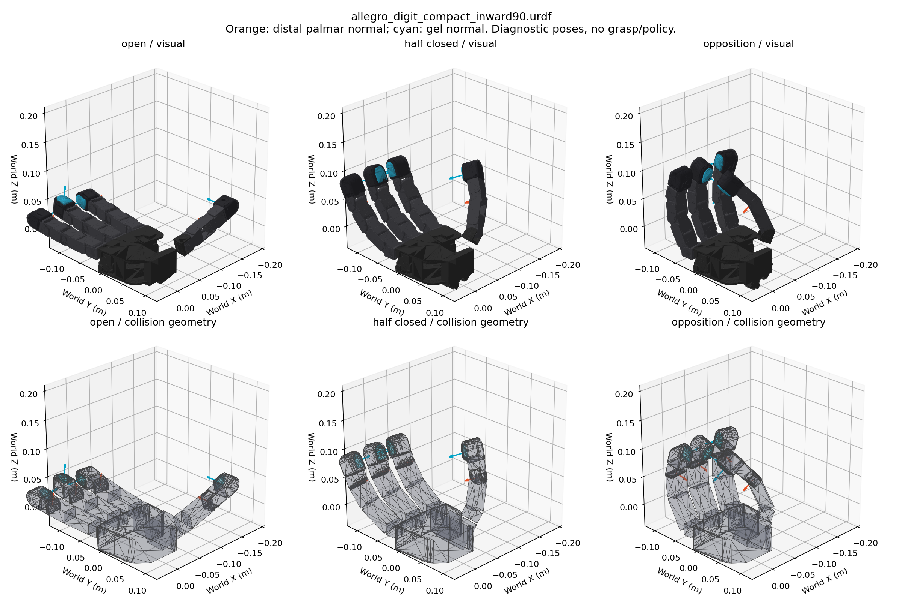

# DIGIT 两侧朝内安装（2026-10-16）

按用户要求，悬空和桌面任务采用相同的右手末节局部安装：

| 手指 | 绕末节局部 +Z 的固定安装角 | 胶面中央朝向（末节坐标） |
|---|---:|---|
| 食指 index | −90° | −Y |
| 中指 middle | 0° | +X |
| 无名指 ring | +90° | +Y |
| 拇指 thumb | 0° | +X |

角度是局部安装角，不是世界坐标旋转，也不是修改关节零位。手掌翻转到桌面朝下时，
无需交换角度正负。三根长指的胶面形成面向指间区域的组合。
旋转的是整个 DIGIT：外观、胶面、外壳碰撞体和其刚体惯量随固定连接一起变换。
安装连接点的 xyz、胶面相对外壳位置、主动关节范围、质量和控制参数均保持。
胶面顶点在末节坐标内的位置会随整个传感器旋转，这是物理装配旋转的正常结果。

参考为仓库中的 `assets/allegro/official_digit/source/neuralfeels_right.urdf`：
食指与无名指固定 tip 关节分别采用 −1.57 和 +1.57 rad。本实现使用精确的 ±π/2。
NeuralFeels 右手资产拇指另有约 −60° 安装；本次按要求保留现有拇指 0°，
所以不是对 NeuralFeels 整只手逐项复现，也没有将其球形碰撞代理引入当前模型。
上述数字装配不等于完成实物支架、线缆空间和负载验证。

## 模型和配置

- `assets/allegro/allegro_digit_compact_inward90.urdf`：27 碰撞体，当前 compact 悬空实验和桌面实验使用。
- `assets/allegro/allegro_digit_official_inward90.urdf`：85 碰撞体，保留原 official 配置的碰撞几何。
- `configs/digit_mount_inward.yaml`：安装角和源/输出模型映射。
- `scripts/build_inward_digit_asset.py`：可复现的生成入口。

两种模型均保持各自原碰撞体数量、自碰撞规则、25 个刚体和 16 个主动关节。
没有因旋转安装而增加凸分解。实际接触对数量仍可能随姿态改变，不能保证运行成本完全相同。

普通 `manip*` 配置已经切换到新安装及独立的 `*_inward90.pt` 缓存路径。
`*_resume20261016` 历史续训配置显式固定旧直线模型，保留旧缓存和权重的物理语义。
原 URDF、缓存、权重未覆盖。需要新安装时使用普通配置，不使用历史 resume 配置。

**本次没有生成新抓取缓存或启动训练。** 新模型哈希与旧模型不同，现有加载检查会拒绝
把旧抓取缓存/权重当作新模型兼容产物。新缓存路径尚不存在，训练会要求先生成抓取。
旧 `canonical_q`、物体位置和预紧参数目前仅保留为待重新搜索的种子，不是已验证的新抓取。
特别是两侧胶面的顶点位置与法线都发生改变，不能只改缓存中的哈希绕过检查。

## 检查结果与边界

27 碰撞体版本：张手、半握、对握三姿态的零 margin 静态碰撞检查均无启用碰撞对穿插。
悬空和桌面任务分别执行 GPU PhysX 的 240 个物理步（2 秒）限力矩 PD 保持，
两种场景、三种姿态均无手部接触力、无手部自接触、无最终关节目标误差。
检查时物体移开，目的为排除安装本身造成的阻挡；不代表已验证新抓取或学会旋转。
桌面保留现有胶面—桌面物理过滤规则，该规则不是本次新增。

单元测试检查整个传感器同步旋转、关节/惯量/几何未变、原缓存哈希失效、
两类任务配置选择与历史续训隔离。证据和图位于
`../../research/digit_orientation_20261016/`。

## 生成与预览

```bash
scripts/python_manip.sh scripts/build_inward_digit_asset.py
# 悬空场景，可在本地带 GUI 运行；不需要抓取缓存或权重。
scripts/python_manip.sh scripts/inspect_digit_mount_sim.py --config manip_compact27_sphere55 --pose all
# 桌面场景。
scripts/python_manip.sh scripts/inspect_digit_mount_sim.py --config manip_tabletop_box45 --pose all
```


