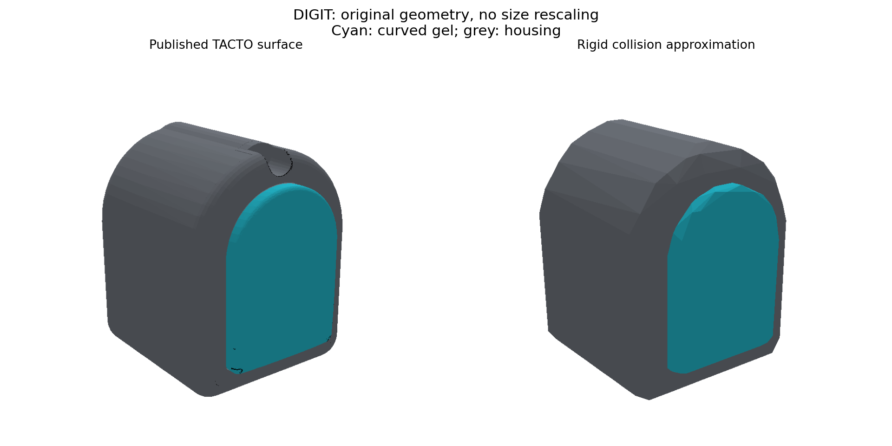

# 官方来源的 Allegro + DIGIT 几何装配

> 本页记录 2026-10-13 的直线安装基线。2026-10-16 普通训练配置已在此基础上采用
> [食指 −90°、无名指 +90° 的安装](inward_digit_mount.md)，原资产保留用于历史实验。

2026-10-13。当前默认资产为 `assets/allegro/allegro_digit_official.urdf`。
它复现 **TACTO 官方发布的 DIGIT 网格及直线安装变换，配合现有 Allegro 右手运动学**。
这是有版本、可核验的公开数字装配，不是对某台实机的尺寸、支架、柔性和惯量全部完成标定。
此前的方盒和11 mm显示连接件属于工程代理，不是官方硬件标准，已从新资产中移除。

## 来源与适用范围

原文件与许可证保存在 `assets/allegro/official_digit/source/`；
逐文件 URL、固定提交和 SHA256 见同目录上一级 `source_manifest.json`。

| 依据 | 本次使用内容 |
| --- | --- |
| [TACTO 官方 Allegro 示例](https://github.com/facebookresearch/tacto/tree/a21d0c4626d74a546d94859226c2fea348babb6a/examples/allegro_hand_description) | `digit.STL` 外观、左手 URDF 的末端局部安装变换 |
| [DIGIT 官方硬件设计](https://github.com/facebookresearch/digit-design/tree/de292229d43eed1deba58b856b2fe1ee04097631/DIGIT) | 胶体 STEP 交叉核验、主/侧 Allegro 适配器 STL、外壳及亚克力 STEP、Quick Start Guide |
| [Allegro 厂商右手模型](https://github.com/simlabrobotics/allegro_hand_ros_v4/tree/b19b18ea130c4fbe343f2c178eec6cb55186a4ac/src/allegro_hand_description) | 掌部 STL、右手关节坐标/轴核验 |
| [NeuralFeels / FeelSight 资产](https://huggingface.co/datasets/suddhu/Feelsight/tree/main) | `left_ball` / `right` URDF 及 `digit.obj`，用于核验外观和对照安装差异 |
| [DIGIT 原始论文 §III-A](https://arxiv.org/html/2005.14679) | 原始整机20 g标称质量；不是本次CAD版本的实测动力学参数 |

FeelSight `assets.tar.gz` 为1,225,774,224字节，下载后核验 SHA256：
`52b1afc63d64d69ffb88667a4ec5dd4d92a05cd4740d9d274d81c369a4a3090f`，
与 Hugging Face LFS 元数据一致。Git仅收录必要的小型模型、来源记录与检查结果，不收录完整压缩包。

官方硬件仓库说明 DIGIT 原生兼容 Allegro，也提供适配器 STL。
但 TACTO 的已发布装配没有把该主/侧适配器作为独立 link 实例化，
本次未找到能将这些独立 STL 精确放入该装配的完整公开坐标变换。
因此原文件保留供核对，**没有凭猜测再加一个支架或宣称完成了该支架的实机装配还原**。
若目标是特定 Allegro 版本和特定硬件适配器，仍需对应装配图或实物测量。

许可证按来源保留：DIGIT 硬件 CC-BY-NC 4.0；TACTO MIT，其手模型目录 BSD；
厂商手模型 BSD；FeelSight 数据卡声明 MIT。第三方资源不因加入本仓库而改变原许可。

## 外形、安装和坐标

- 使用官方网格的原始米制坐标，不以论文名义尺寸重新缩放。
  TACTO 完整 DIGIT 网格包围盒约为 **32.33×27.00×34.02 mm（局部X/Y/Z）**。
  这与原始论文的20×27×18 mm不是相同尺寸描述，不能把后者强套到这个公开CAD版本。
- 胶体是有厚度的弧面实体，包围盒约 **4.07×18.40×25.00 mm**，不是零厚度平面。
  网格拆分为外壳与胶体，但显示三角面集合保持原始STL几何，仅有OBJ小数序列化误差。
  显示外壳包含原模型的内部部件；碰撞采用下述简化。
- 三根长指安装相对末节局部坐标为 `xyz=[0,0,0.0147] m`；
  拇指为 `xyz=[0,0,0.0303] m`；**四者 `rpy=[0,0,0]`**，直接取自固定版本TACTO URDF。
- 保留当前右手的掌部、拇指基部及16个主动关节；这些关节的 `origin/axis` 与厂商右手URDF一致。
  仅借用TACTO末节局部安装变换，未将整只左手的世界坐标装配拷贝成右手。
- 原末端固定圆头由DIGIT模块替代，无新增主动关节；仍为16 DOF、25个手部刚体。
  胶体和外壳分别为固定连接的刚体，保留独立接触读数。
- 胶体坐标原点选为网格最前端顶点，+X向外，+Z沿手指长轴。
  这是本项目明确声明的感知坐标约定，不是DIGIT相机光学坐标系。
  胶体弯曲并凸出指腹，因此“方向一致”不意味着整个胶面与指腹处处共面。

胶体 STEP 经过0.02 mm离散化、轴置换和明确记录的平移配准后，
CAD顶点到TACTO胶体表面的距离为：平均0.031 mm、P95 0.094 mm、抽样最大0.204 mm。
这是几何交叉检查；配准变换由网格推导，不是官方发布的装配变换，也不证明两者是完全同一CAD修订版。



## NeuralFeels 到底采用什么

本次已实际取得并读取FeelSight资产，修正上一轮“未取得大压缩包内URDF”的证据缺口。
NeuralFeels的 `digit.obj` 与TACTO网格顶点最近距离最大约 **0.00083 mm**，
与OBJ导出精度相符，支持其使用相同弧形DIGIT外观。
不能因此推断其接触物理与该显示网格相同：

- `allegro_digit_left_ball.urdf` 用半径13.5 mm球体作为指尖碰撞；掌部还有很小的盒体代理。
- 该左手资产食指/无名指分别带约 +90° / −90°偏航；
  右手资产相应为 −90° / +90°，拇指约−60°。
- 这些是其公开资产中的设置，不等于实机支架尺寸的完整测量记录。
  本项目采用上面的TACTO直线方案，**不冒充NeuralFeels逐项装配复现**。

## 碰撞与动力学：改了什么、仍近似什么

本次同时替换原掌部/指节的粗略碰撞体，使用网格凸分解。
原因是前轮已查明掌部盒体与拇指在张手/半握姿态中穿插；仅换DIGIT显示无法修复该问题。
掌部直接由厂商STL生成；其与继承的掌部OBJ顶点差异小于0.001 mm。
其余指节由现有手部网格生成。**没有通过关闭掌部—拇指或跨手指碰撞隐藏穿插**。

每块凸体不超过64顶点，V-HACD分辨率400000、concavity=0.001，生成参数和SHA写入`mesh_manifest.json`。
胶体一个凸体、外壳一个凸体；掌部23块，其余不同指节1–5块。
外壳碰撞采用三块外壳的凸包，填平端口和内部空腔，内部电子器件不单独参与碰撞。
显示保留这些细节。指节孔洞和凹槽也存在凸分解误差。

| 几何检查 | 平均距离 | P95 | 抽样最大距离 |
| --- | --- | --- | --- |
| 原胶体表面→胶体碰撞面 | 0.098 mm | 0.171 mm | 0.228 mm |
| 声明的外壳凸包→外壳碰撞面 | 0.279 mm | 0.427 mm | 0.529 mm |
| 原掌部表面→掌部碰撞面 | 1.187 mm | 3.271 mm | 6.327 mm |

上述是固定随机种子的顶点+3000个面采样距离，不是严格Hausdorff上界，也不是全部外壳原表面误差。
胶体碰撞顶点反向到原胶体表面最大约0.254 mm；完整各部件结果见`mesh_fidelity.json`。
掌部等凹结构仍存在毫米级简化，不能称为完整CAD精确接触；PhysX的接触偏移还会影响实际接触发生距离。

动力学变化与保留项：

- 每个DIGIT从旧代理22 g改为原论文标称20 g；按均匀凸包体积将质量分到外壳约18.908 g、胶体约1.092 g。
  COM/惯量由对应包络估计，**缺少该网格版本的实际材料/电子器件质量分布，未做系统辨识**。
- 胶体仍是刚体，无有限元、软胶形变、光学触觉图像或TACTO渲染。
- 保持原控制器、力矩限幅、手部质量惯量、手部关闭重力设置、碰撞过滤规则、奖励和四路binary接触观测。
  厂商URDF的执行器配置未代替当前HORA控制配置；这些动力学边界仍见实现审计文档。
- 默认物体仍是55 mm球体，没有在本次改装中同时扩大物体。

## 验证与使用

证据位于项目根目录 `research/digit_mount_review/`：

- `allegro_digit_official.json/png`：三姿态静态FK和零margin凸体检测，无启用碰撞对穿插。
- `official_physx.json`：实际GPU PhysX以当前限力矩PD保持三姿态各120物理步，
  物体移开后均无手部接触、无姿态偏移；未再出现旧掌部盒体的初始穿插。
- `official_collision_pairs.json`：32环境随机关节目标，跨指碰撞确实发生；
  被排除的相邻/固定组件不产生接触；仅在对照测试中关闭自碰撞后接触消失。
  该压力测试峰值力不作为真实手部可承受载荷。
- 3环境40控制步GPU smoke通过，状态/奖励有限；这不评价抓取或旋转成功。
- 22项回归测试通过，覆盖来源三角面、官方安装变换、关节/碰撞规则不变、凸体限制及外部网格篡改检测。

配置已切换到新资产和独立的 `*_official_grasps.pt` 缓存名，**尚未生成新抓取、启动正式训练**。
URDF绑定网格manifest哈希，任务启动逐文件核验，修改外部网格不能继续沿用旧缓存身份。
旧两版URDF保留供历史回放；旧权重不能直接切换到新手模型后声称还是原实验。

本地只查看装配，不需要权重、rsync或几何构建依赖：

```bash
cd ~/Desktop/In_Hand_Reconstruction
git pull --ff-only origin main
cd In_Hand_Manip
bash scripts/python_manip.sh scripts/inspect_digit_mount_sim.py --pose opposition
# 或 --pose open / --pose half_closed / --pose all；Esc退出。
```

静态检查或重新生成模型时才安装可选依赖：

```bash
bash scripts/python_manip.sh -m pip install -r requirements-geometry.txt
bash scripts/python_manip.sh scripts/inspect_digit_mount.py
bash scripts/python_manip.sh scripts/assets/plot_digit_detail.py
# 只生成URDF，不改变已提交的网格：
bash scripts/python_manip.sh scripts/build_official_digit_asset.py
# 更改凸分解时，必须先生成网格再重建URDF，并重新验证及生成抓取：
bash scripts/python_manip.sh scripts/assets/prepare_digit_meshes.py
bash scripts/python_manip.sh scripts/build_official_digit_asset.py
bash scripts/python_manip.sh scripts/assets/check_mesh_fidelity.py
```

独立STEP核验需要Python3.12的CAD工具环境（无需修改项目Python3.8）：
`cadquery-ocp==8.0.1.1.0, trimesh==5.1.1, numpy==2.5.4, scipy==1.18.1`。
使用该环境Python运行：

```bash
python scripts/assets/tessellate_step.py \
  assets/allegro/official_digit/source/digit_gel.step \
  ../research/digit_mount_review/sources/cad_meshes
```

然后运行项目环境的`check_mesh_fidelity.py`，存在CAD离散网格时会附加CAD对照。
核心训练/回放无需CAD工具，已提交的OBJ可直接加载。
服务器完成静态图与无窗口仿真；本地GUI显示、线缆布置、螺钉及真实硬件装配尚未实测。
