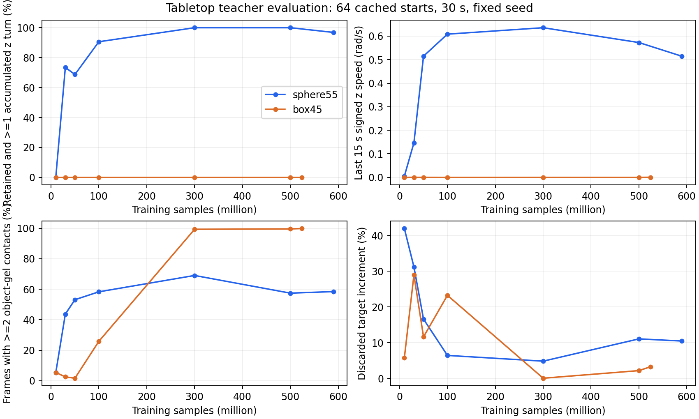

# 桌面训练结果：2026-10-18

读取时间约 13:32–13:36（北京时间）。球体约 6.43 亿步，恢复后的立方体约 5.81 亿步，均继续运行。
两组均已完成 5 亿步阶段。立方体恢复后未再记录训练中途崩溃；部分阶段结束仍发生已知销毁崩溃，检查点验证后进入评估。5 亿步阶段两组均正常退出。

## 最新已保存权重补测

在各自 GPU 上另建 64 环境评估，使用相同种子 215、缓存中均匀选取的 64 个初始状态，每次 600 控制步（30 秒），执行教师均值动作。正在训练的进程没有更改。
这些是特权教师测试，尚未验证仅触觉/本体学生或未知物体泛化。缓存属于训练初始化集合；64 个状态不代表 64 个未知物体。圈数是逐步旋转向量沿指定 z 轴投影的累计量，不是已证明无偏轴的纯 yaw 整圈。

| 指标 | 球体 | 立方体 |
|---|---:|---:|
| 已保存训练步数 | 589824000 | 524288000 |
| 保持至结束 | 96.88% | 100.00% |
| 保持并累计至少一圈 | 96.88% | 0.00% |
| 平均累计圈数 | 2.686836 | 0.001029 |
| 后半段角速度 rad/s | 0.514581 | 0.000309 |
| 至少两路真实接触帧比例 | 58.49% | 99.83% |
| 至少一路真实接触帧比例 | 84.52% | 99.92% |
| 动作分量裁剪率 | 23.65% | 0.02% |
| 目标增量损失比例 | 10.44% | 3.25% |

球体最新保持/一圈成功率为 62/64，立方体保持为 64/64，一圈为 0/64。球体偏轴角速度 RMS 约 0.387 rad/s，说明仍有明显偏轴运动。

## 学习轨迹与判断

- 球体从 1000 万步的一圈成功率 0%，提高到 3000 万步 73.4%，1 亿步 90.6%，3 亿和 5 亿步 100%；最新保存点 5.898 亿步为 96.9%。后半段角速度从早期接近零提高至约 0.5–0.7 rad/s，已不属于仅开始转动、随后停住。
- 球体两路接触覆盖在 3 亿步约 69.1%，5 亿步 57.5%，最新 58.5%。最新任意一路胶面接触覆盖约 84.5%；无胶面接触帧不等于完全失去支撑，桌面及外壳仍可能支撑。未记录完整接触来源分解，不能声称胶面完成了全部操作。
- 诊断门槛“每回合 >=80% 帧至少两路物体胶面接触”下，最新两组 qualified 成功率均为 0。球体是不满足接触覆盖门槛，立方体是不满足旋转门槛；该门槛是项目评估选择规则，不是论文统一标准，也不是新增训练奖励。
- 立方体从早期频繁失触发展为几乎全程两指夹持，3 亿至 5.24 亿步的累计旋转均近零。扩大预算让它学会稳定保持，但没有解决旋转探索。
- 球体的更晚权重并未持续优于早期模型。8,939 万步 reward-best：64/64 保持及一圈，平均 3.62 圈，两指覆盖 71.0%；2.611 亿步 reward-best：64/64，3.38 圈，两指覆盖 70.6%。宜保留这些候选，与最新权重多种子复测。单种子 64 样本不足以认定最新退化显著。

## 当前瓶颈

最近 100 轮采样更新（约 1311 万步）的日志均值：球体旋转速度约 0.647 rad/s，立方体约 0.00075 rad/s。立方体动作变化惩罚约 -0.00084/步，目标增量损失约 4.6%，扭矩限幅比例为 0；最新确定性评估动作裁剪仅约 0.021%。这不支持将其停转主要归结为动作饱和。
立方体每步接触奖励约 +0.0467、靠近奖励约 +0.0470、旋转奖励约 +0.00036、初始姿态惩罚约 -0.0318、失败惩罚均值约 -0.0782。这与“保持容易获得辅助奖励、旋转探索难且有失触成本”的局部最优一致，但单条训练曲线不能证明某一奖励项是原因。
立方体最新保存点高斯动作标准差各维约 0.042–0.129（归一化动作），entropy_coef=0。动作噪声已较小；单纯延长同一训练不保证能离开稳定夹持。负微分熵本身不是错误。
球体主要需改进接触覆盖和偏轴，而不是从零寻找能转动的策略；立方体需解决从稳定夹持到可转动接触序列的探索。建议分别做对照：球体先多种子和长时回放比较早期/当前候选，再考虑以覆盖率选优；立方体先检查夹持状态的小角度旋转/换指可行性，再比较课程与探索强度，避免同时改多项奖励。当前分析未修改任何训练参数或停止实验。

## 接触查询成本

最近 100 轮：球体查询墙钟/进程 CPU 约 549/549 ms，立方体约 606/606 ms；分别占一次 16384 环境控制步的约 27.6%/26.0%。每环境约 33.5/37.0 微秒。这是查询与聚合耗时，不是开关筛选的完整 A/B 增量。当前日志 Last FPS 约球体 8200、立方体 6800；恢复后的累计 FPS 因历史步数/新计时混合而虚高，不用于判断吞吐。

原始数据：training_metrics.json、stage_evaluations.json、sphere55_latest_evaluation.json、box45_latest_evaluation.json。
