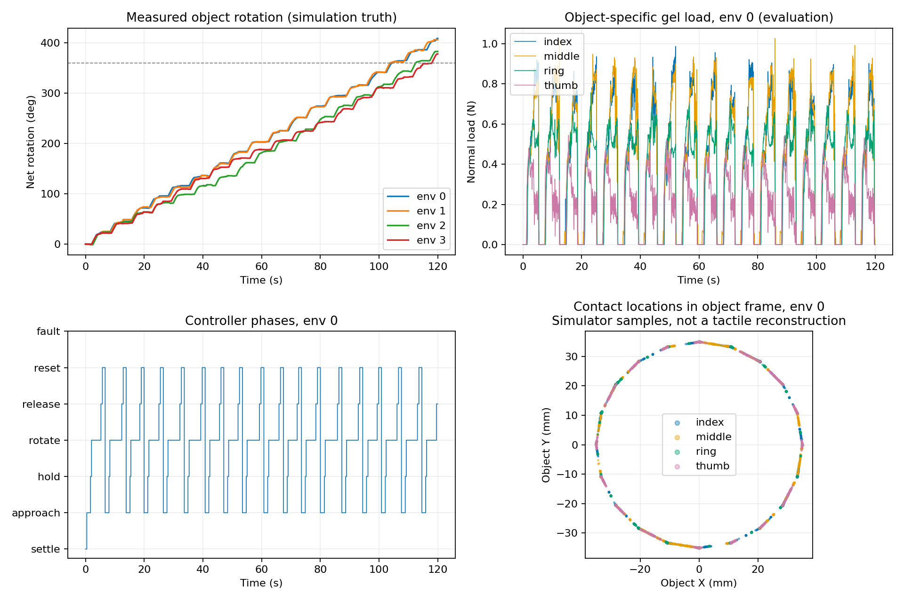

# 桌面圆柱扫描：贴合、预载与推进幅度改进

2026-11-06（Asia/Shanghai）。修改独立扫描控制器及其配置，没有修改 RL 配置、手部资产、碰撞过滤、PD 增益、硬件力矩上限或桌面摩擦。没有训练/提交/推送操作。

## 诊断证据

- 旧脚本并非完全没有力反馈：目标为0.5 N，但切换旋转只检查二值接触及短暂驻留，未等待预载建立。旧300秒记录中拇指推进期物体法向载荷中位数仅0.005–0.014 N，四指接触帧比例37.5%–38.9%。
- 旧初始IK胶面法向与期望径向误差约23.0/6.5/8.0/17.6°；随后沿用实际倾斜法向，无法主动纠正到目标水平法向。
- 食指/无名指侧向安装后，其三个屈伸关节对胶面法向的导数接近零，主要能改变位置而不能独立改变水平朝向。固定手腕下，不可能任意指定四指位置与全部胶面方向。
- 旧在线IK对完整角速度施加代价，连绕胶面法向的无关转动也被约束；新实现使用法向向量本身的Jacobian。
- 首轮新增预载验收发现食指动作饱和，载荷仍约0.15 N；单纯提高验收阈值导致closure_limit，并没有产生更强夹持。需要扫描专用目标增量权限，不能仅调一个接触阈值。

## 最终改动

1. 开手方位按胶面法向的水平投影选择；接近/保持目标法向取水平向内，保留并报告实际IK误差。复位使用真实可达的开手法向，避免与开手位置相互冲突。
2. 每指净接触载荷目标0.5 N；四指滤波值均≥0.30 N，中心法向倾斜≤12°、方向误差≤15°，连续0.3秒后才推进。净载荷与评估用物体法向载荷不是同一量，不能声称法向力恒定0.5 N。
3. 旋转时四指滤波值均≥0.20 N才推进，否则暂停切向进度并继续调载；连续不足0.6秒就释放重试。原实现用旋转阶段年龄判断失触，现在计时的是连续弱接触时长。
4. 仅扫描的action_scale和max_joint_step从0.026改为0.05 rad；扫描后的原始动作不能直接和旧RL动作标签混用。
5. 默认圆柱由直径60改为70 mm，高70 mm、质量60 g保持。默认推进从10°/1.5秒改为30°/2.5秒有效推进时间；实际转角必须独立测量。保留60 mm、20°/1.7秒配置。
6. 法向权重0.015→0.025；侧面接触高度允许低权重调整，超出0.522–0.556 m恢复完整纠偏。接近/释放/复位速度分别8/20/25 mm/s，力反馈增益0.002→0.008，径向旋转补偿上限3→6 mm。
7. 轨迹新增实际/目标胶面法向；报告新增四指接触比例、各指法向载荷中位数、倾斜p95。

## 最终仿真验证

命令：`bash scripts/run_tabletop_scan.sh --headless --seconds 120 --num-envs 4 --offset-mm 2 --seed 44 --device cuda:0`。运行时CUDA_VISIBLE_DEVICES映射到当时物理GPU2，未中断其他用户进程。四环境都从开手开始连续运行，不在循环间重置物体。

| 环境 | 完整复位循环 | 完成预定推进 | 弱接触提前释放 | 净转角 | 平均每循环净转角 | 推进四指接触 | 最大XY漂移 |
|---|---:|---:|---:|---:|---:|---:|---:|
| 0 | 17 | 12 | 6 | 409.2° | 22.8° | 95.97% | 6.66 mm |
| 1 | 18 | 15 | 3 | 406.5° | 22.6° | 96.67% | 9.85 mm |
| 2 | 17 | 13 | 4 | 383.3° | 21.5° | 95.38% | 9.22 mm |
| 3 | 17 | 12 | 5 | 378.4° | 21.1° | 94.61% | 7.26 mm |

四环境均正常退出；后半程各自继续转动190–206°。桌面支撑99.96%–100%，非胶面物体接触为0%，采样最大胶面净载荷1.00–1.03 N，最大物体倾角1.61–2.26°。URDF与模拟器位置误差小于0.001 mm。
推进期食指/中指/无名指/拇指法向载荷中位数约0.64–0.65 / 0.67–0.68 / 0.53–0.54 / 0.25–0.26 N；胶面中心法向倾斜p95约9 / 2 / 3.5 / 9°。因此是近似竖直，不是完全零倾角。
70次已经结束的推进中52次完成预设轨迹，18次弱接触提前释放。完整复位循环包含这些提前释放，不能把69个循环全部称为完成30°推进。所有已完成循环净转角为正，范围16.6–26.7°；物体实际转动不同于30°轨迹指令。
与旧版本平均约8.7–9.0°/循环相比，本次约21–23°；但控制器、尺寸和评估时长均有变化，这不是隔离单一因素的因果消融。
同一新控制器的两环境45秒对照：60 mm/20°四指接触82.2%–83.5%；70 mm/30°96.8%–96.9%。两者含尺寸和指令角度差异，仅用于选择此基线默认演示。

## 检查与边界

- 36项测试通过，覆盖弱接触不能触发推进、预载姿态不合格不能推进、暂停/恢复与连续失触计时、法向轴自由转动及已有桌面/接触/控制回归。shell语法和git diff --check通过。
- 最终验证的源码哈希与工作区一致；旧baseline源码哈希与修改前备份一致。见verification.json。
- 这是刚体仿真、低摩擦桌面、已知放置中心的圆柱测试，未验证实机、未知形状或新窗口视频；没有TACTO图像、胶体形变或触觉重建。
- 四胶面完全正对物体、无滑动地刚性旋转大角度受当前安装和固定手腕运动学限制；本版允许接触滚滑和小幅高度调整。有效法向载荷不能代替有效触觉图像面积的验证。
- 胶面净载荷为控制输入，目标物体接触身份/真值位姿/表面采样仅用于评估。对任意形状，单纯碰到就停不能保证局部法向匹配和可用成像。

## 使用

```bash
bash scripts/run_tabletop_scan.sh --seconds 60
# 60 mm 对照
bash scripts/run_tabletop_scan.sh --config configs/tabletop_scan_cylinder60.yaml --seconds 60
```



所有探测包括失败记录均保留：baseline、probe01–probe05、final_70_long。原始配置、轨迹、事件和评估在各运行子目录，修改前文件位于before。
