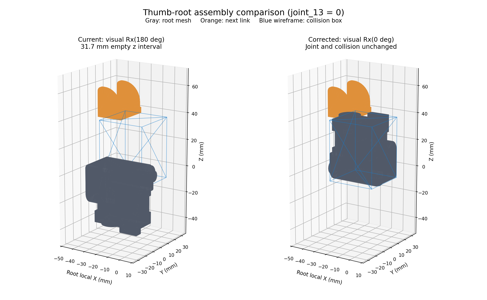

# 拇指根部装配错误审计与隔离修正

2026-10-18。用户截图中的倒置和断开现象可从当前 URDF 文件复现。此前检查遗漏了此问题；文件来源、关节参数一致和无碰撞穿插，不能代替装配正确性检查。

## 根因与传播

当前 `link_12.0/visual/origin` 为 `rpy="3.1415926518 0 0"`，即局部 X 轴翻转 180°。`joint_13.0` 的连接位置保持 `[-0.027, 0.005, 0.0399] m`，没有随显示翻转。

在 joint_13=0 的局部坐标比较中，错误根部网格 z 范围为 [-41.5, 8.0] mm，下一节 link_13 网格从 z=39.733 mm 开始，二者存在 31.733 mm 的空区间。去掉错误翻转后根部范围为 [-8.0, 41.5] mm，覆盖到关节接口区域。这是几何区间检验，不是对实机制造间隙的标定。

HORA 提交 `410d95824dd28b198f6d6910cb4c09330a6303be` 同时保留两个模型：

- `allegro.urdf` 保留错误显示翻转。
- `allegro_internal.urdf` 注释掉该翻转；HORA 的 `configs/task/AllegroHandHora.yaml` 实际选择后者。

我们的 `scripts/build_digit_asset.py` 与 `scripts/build_official_digit_asset.py` 都从前者构建，继承了不适用于这份网格的显示变换。这是适配时基准选择和验证的错误，不能因其能在上游某个文件找到就认定合理。后续 ±90° DIGIT 安装只旋转食指/无名指模块，没有造成这次拇指根部错误；错误在那之前已经存在。

## 物理与运动学影响

| 项目 | 当前 27 体模型 | 历史 85 体模型 |
|---|---|---|
| 根部显示网格 | 错误 Rx(pi) | 错误 Rx(pi) |
| 根部碰撞 | 厂商 box，未翻转 | 3 个凸包复制了错误 Rx(pi) |
| 主动关节 | 继承 HORA 运动学 | 继承同一运动学 |
| 错误影响 | 该处显示与碰撞不一致 | 显示与碰撞几何均受影响 |

27 体的碰撞盒中心是 [-17.9,9,14.5] mm，尺寸 [35.8,34,45.5] mm；仿真使用这个盒，不直接使用显示网格计算接触。因此画面看起来空着的位置可能存在碰撞实体，显示中倒置突出的部分也不对应真实碰撞表面。不能从截图推断关闭了拇指碰撞。

85 体构建器将 visual/origin 复制给 collision/origin，把错误传播到根部凸包。对这版资产不能再笼统说“仅有显示错误”或“手部几何已验证正确”。此前训练结果依赖该历史几何，不能据此推断真实手部效果；也不能直接证明这就是历史训练失败的原因。

## 当前 27 体整手核对范围

与 HORA 实际使用的 internal 资产逐项比较：

- 16 个主动关节 parent/child、origin、axis、角度范围、effort、velocity 全部一致。
- 原掌部和 16 指节的 inertial 元素一致；9 种原手部 OBJ 文件与 HORA 原文件逐字节一致。
- 原手部显示 origin 唯一差异是 link_12 的错误翻转。
- 原手部碰撞差异：掌部改为 3 凸包；link_3/7/11/15 改为末节单凸包。其余原手部碰撞元素与 internal 基准一致。
- 四个原指尖固定 link 被替换为 8 个 DIGIT housing/gel link；DIGIT 固定安装、惯量和胶面/外壳碰撞是本项目适配内容。食指 -90°、无名指 +90° 为此前用户要求的安装。
- 与下载的厂商右手 URDF 比较，主动关节坐标/轴/角度范围一致；effort/velocity 不同：当前继承 HORA 的 0.35/6.283，厂商文件为 15/7。这是既有控制基准差异，不是此次修正。
- 当前桌面冻结快照与被检查的 27 体 URDF 字节一致。

这些结论是文件层级和正运动学的核对，不等于已经完成真实硬件装配、惯量、接触参数验证，也不是对整个项目所有实现给出“无其他错误”的保证。

## 独立来源核验

从固定厂商提交 b19b18ea130c4fbe343f2c178eec6cb55186a4ac 下载了全部 9 种手部 STL。当前 OBJ 与各 STL 的顶点最近距离最大均小于 0.001 mm，包括拇指根部。网格文件本身未被重新雕改；错误来自装配变换。

厂商这份 URDF 也包含 Rx(pi)，说明仅做 URDF 参数文字一致性核对不够。必须与配套几何、关节连接位置以及 HORA 实际使用版本交叉检查。来源 URL/哈希记录在 vendor_sources.json，网格比较在 mesh_comparison.json。

## 本次完成的修正和检查

新增隔离资产：`In_Hand_Manip/assets/allegro/allegro_digit_compact_inward90_thumb_visual_fixed.urdf`。

它只把 link_12 visual/origin 的 rpy 由 pi,0,0 改为 0,0,0，没有改动碰撞、关节、惯量、传感器安装、力矩参数或运行配置。构建脚本拒绝覆盖历史文件，也拒绝把 85 体错误当作仅显示修正处理。

- 4 项回归测试通过：完整语义差异限定到一个显示字段；三姿态所有 link 的 FK 逐元素相等；31 mm 错误空隙能被测试发现；历史文件覆盖和 85 体误修被拒绝。
- 三姿态静态碰撞检查通过，启用碰撞对穿插数均为 0；这与物理几何未改动一致。
- 训练快照、历史缓存、当前训练配置未覆盖。新的 URDF 文件身份变化，现有加载器会校验 asset hash；没有绕过缓存或检查点校验，也没有把旧权重直接换到新文件上运行。
- docs/official_digit.md 与 docs/collision_baselines_20261014.md 已加更正说明。
- 旧构建脚本和历史 85 体资产保留为追溯证据；新显示修正版由 build_thumb_visual_fix.py 生成。85 体若重新使用，需要另行修正物理几何并重验，不能沿用旧的“通过”结论。

预览独立修正版（不加载旧权重，在 In_Hand_Manip 目录执行）：

```bash
bash scripts/python_manip.sh scripts/inspect_digit_mount_sim.py \
  --asset assets/allegro/allegro_digit_compact_inward90_thumb_visual_fixed.urdf \
  --pose opposition
```



机器可读记录：joint_audit.json、full_hand_audit.json、gap_geometry.json、asset_identity.json。
